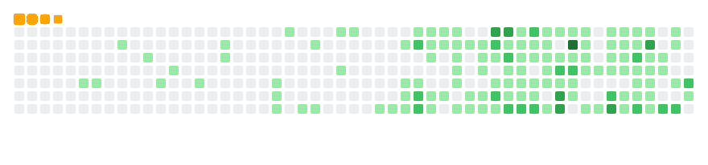

  
  
  

---

## 👨‍💻 About Me

Hi! I'm **Pritosh**, a Computer Science undergraduate at **Delhi Technological University (DTU)**. I enjoy solving problems, exploring how intelligent systems work, and turning ideas into useful software.

- 🧠 Exploring **Machine Learning, AI and intelligent applications**
- ⚙️ Interested in **backend engineering**, especially with **Go**
- 🧩 Practising **Data Structures & Algorithms** and problem solving
- 🛠️ Building projects that combine models, APIs and practical interfaces
- 🌱 Always learning, experimenting and improving

---

## 🧰 Tech Stack

**Languages**

  
  
  
  
  

**AI / Machine Learning**

  
  
  

**Web / Backend / Tools**

  
  
  
  
  
  
  
  

---

## 🚀 Featured Projects

  
  
  
  

  
<b>More projects</b>

  - 🍕 [Food Classifier](https://github.com/Pritosh2387/Food-Classifier) — image classification with TinyVGG and EfficientNet-B0.
  - 🧩 [DSA](https://github.com/Pritosh2387/DSA) — data structures and algorithm practice.
  - 📚 [ML Specialization](https://github.com/Pritosh2387/ML-Specialization) — notes and code from ML learning.

---

## 📊 GitHub Analytics

 

 

 

---

## 📈 Contribution Activity

---

## 🧩 LeetCode Dashboard

[**View my LeetCode profile →**](https://leetcode.com/FlameFit32)

---

## 🐍 Contribution Snake

*The snake animation is generated automatically every day using GitHub Actions.*

---

## 🤝 Let's Connect

  

### ✨ Build • Learn • Iterate • Repeat

*“Great things are built one commit at a time.”*

